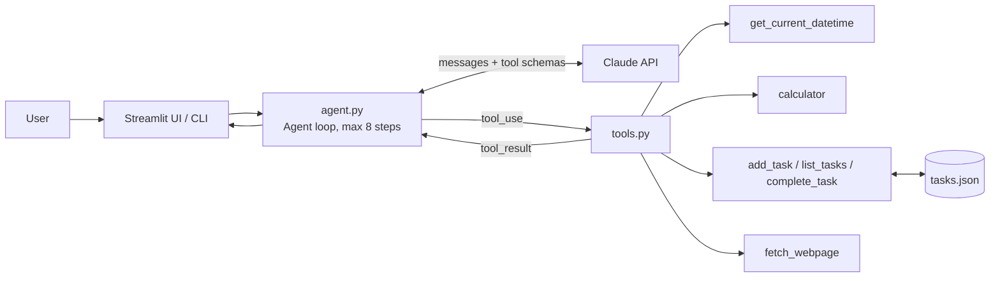

# TaskPilot — Agentic AI To-Do Assistant

An **agentic AI agent** that takes a goal (e.g. "Plan my exam prep for 5 days"), decides which tools to use, calls them in a loop, and returns a finished plan. Built with the Claude API (tool use) and Streamlit.

## Why it is "agentic"
The LLM is not just answering. It runs an autonomous **Plan → Act → Observe → Repeat** loop:
1. Reads the goal and decides the next action.
2. Calls a tool (date lookup, calculator, add task, fetch web page, etc.).
3. Observes the result and decides whether to call more tools.
4. Stops when the goal is done and summarises.

## Architecture / Schema



### Tool schemas (JSON, given to the LLM)
| Tool | Inputs | Purpose |
|---|---|---|
| `get_current_datetime` | none | Today's date/time |
| `calculator` | `expression` | Safe arithmetic (AST-based, no `eval`) |
| `add_task` | `title`, `due_date`, `priority` | Create a task |
| `list_tasks` | `show_done` | View tasks |
| `complete_task` | `task_id` | Mark done |
| `fetch_webpage` | `url` | Read page text (http/https only) |

### Data schema (`tasks.json`)
```json
{"id": 1, "title": "Revise Unit 1", "due_date": "2026-10-12", "priority": "high", "done": false}
```

## Setup
```bash
git clone <your-repo-url>
cd taskpilot
pip install -r requirements.txt
export ANTHROPIC_API_KEY=your-key      # Windows: set ANTHROPIC_API_KEY=your-key
streamlit run app.py                   # web UI
# or: python agent.py                  # command line
```

## Example prompts
- "Plan my exam preparation for the next 5 days, 3 subjects, and add tasks."
- "What is 18% GST on 4,250? Add a task to pay it by Friday."
- "Read https://example.com and add a task for anything I need to do."

## Safety notes
- Calculator uses a restricted AST parser, not `eval`.
- Web fetch allows only http/https, limited size and timeout.
- Tool errors are caught so the agent can recover instead of crashing.
- API key is read from environment or UI, never committed (`.gitignore`).

## Files
- `agent.py` — agent loop
- `tools.py` — tool functions + JSON schemas
- `app.py` — Streamlit UI
